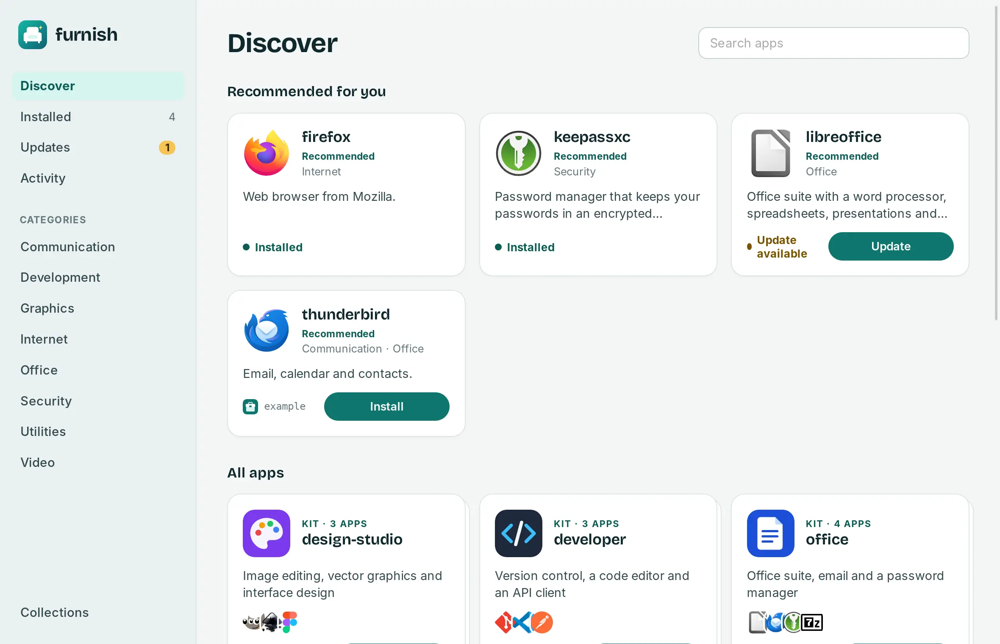

# furnish

A self-service app catalog for an organization's Linux, macOS and Windows computers, kept in git.

Status: alpha. Builds of the main branch are published; there are no releases. Apps install with administrator rights, so only add collections you trust.



## What furnish does

An organization keeps its apps in a git repository, called a collection. Each app is a short [DSC v3](https://learn.microsoft.com/powershell/dsc/overview) file that says which package to install with which package manager. furnish shows the collection's apps to the people using it and installs the one they pick.

| For | furnish provides |
|---|---|
| People using the computers | A desktop app and a `furnish` command to find, install, update and uninstall apps; a preview of each step before it runs |
| Collection authors | Apps for pacman, apt, dnf, zypper, Homebrew, Nix and winget from one file; installer files (`.deb`, `.rpm`, `.pkg`, `.dmg`, `.msi`, `.exe`); kits, dependencies, questions and recommendations |
| IT administrators | A policy in each system's managed settings: preset collections, locked settings and options, branding; a service that installs for people without administrator rights; sign-in with the organization's account instead of a VPN |

## How it differs

- furnish is one program; collections come straight from git, and no server is needed. An optional proxy lets people sign in from outside the network.
- An app's state comes from its file: furnish compares the computer with it instead of keeping its own records.
- The [DSC](https://github.com/PowerShell/DSC) engine is compiled into furnish, so there is nothing else to install.
- Updates install automatically, and wait while the computer is busy.

## Start here

On Debian or Ubuntu, from the signed package repository (key [`gpg-key.asc`](packaging/repo/gpg-key.asc), fingerprint `3A87 437D E7A2 B5DE 9436  AD89 8C29 D9C7 FFF4 823E`):

```sh
sudo install -d /etc/apt/keyrings
sudo curl -fsSLo /etc/apt/keyrings/furnish.asc https://furnish-self-service.github.io/furnish/gpg-key.asc
sudo curl -fsSLo /etc/apt/sources.list.d/furnish.list https://furnish-self-service.github.io/furnish/alpha/furnish.list
sudo apt update && sudo apt install furnish
```

The [docs](https://furnish-self-service.github.io/docs/) cover Fedora, openSUSE, NixOS, the macOS and Windows downloads, and building from source. Then add the example collection and list its apps:

```sh
furnish collection add https://github.com/furnish-self-service/self-service-example.git
furnish list
```

```
   App          Collection  Categories          Description
·  gimp         example     Graphics, Photo     ★ Image editor for photo retouching, image composition and painting.
✓  git          example     Development         Distributed version control system.
✓  htop         example     System, Monitoring  Interactive process viewer for the terminal.
```

✓ is installed, · not installed, ★ recommended for you.

## An app

```yaml
# apps/htop.dsc.yaml
metadata:
  furnish:
    description: Interactive process viewer for the terminal.
    categories: [System, Monitoring]
    icon: icons/htop.svg
resources:
  - name: htop
    type: Furnish/Package
    properties:
      name: htop
```

## Docs

- [Get started](https://furnish-self-service.github.io/docs/alpha/index.html): installing furnish and adding a collection.
- [Using the app](https://furnish-self-service.github.io/docs/alpha/using.html): installs, updates, options.
- [Command line](https://furnish-self-service.github.io/docs/alpha/cli.html): the `furnish` command.
- [Writing a collection](https://furnish-self-service.github.io/docs/alpha/collections.html): apps, kits, questions, private repositories.
- [For admins](https://furnish-self-service.github.io/docs/alpha/admins.html): the policy, sign-in without a VPN, branding, the furnish service, NixOS.
- [Endpoint reference setup](packaging/endpoint): the proxy for signing in from outside the network.
- [DSC v3 guide](docs/dsc-v3-guide.md): how DSC v3.3 behaves, checked against its source code.
- [authoring-dsc-v3 skill](.claude/skills/authoring-dsc-v3/SKILL.md): rules and a tested example for writing DSC v3 documents. Claude Code loads it in this repository; copy the folder to use it in yours.

The docs' sources are in [`docs/site/`](docs/site); `docs/screenshots/run.sh` retakes the screenshots.

## Development

Use the cargo aliases `cargo b`, `cargo t` and `cargo r`: a plain debug build fails without PowerShell, because a DSC build script runs `pwsh` in debug builds, and the `fast` profile avoids that. `cargo cw` checks the Windows build from Linux (needs `mingw-w64-gcc`). `tests/e2e.sh` installs and uninstalls against a fake package manager; the other scripts in `tests/` cover the desktop app, the furnish service, packages, Nix, private repositories and the endpoint.

The desktop app is in `gui/` (Tauri 2 and Svelte): `cd gui && npm ci && npx tauri dev -- --profile fast` runs it, `npm run bundle` builds its installers with the CLI inside, and `gui/scripts/dev-desktop-entry.sh` gives development builds their icon on Linux desktops. `packaging/linux/build.sh` builds the published Linux packages on Ubuntu 22.04.

`vendor/tree-sitter-dscexpression` holds grammar sources that DSC generates at build time; `scripts/vendor-dsc-grammar.sh <tag>` regenerates them for a new DSC version.

## License

MIT. The installers contain open-source components under their own licenses, listed in [THIRD-PARTY-LICENSES.html](THIRD-PARTY-LICENSES.html) (`node scripts/licenses.mjs` regenerates it).
