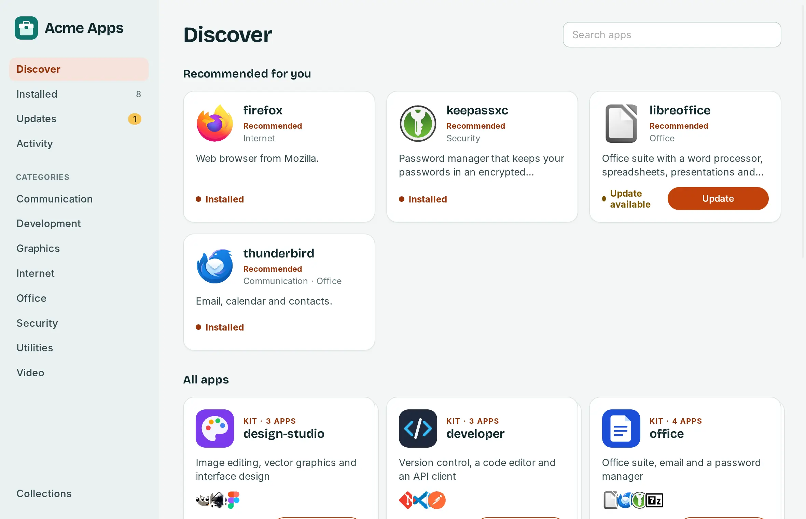

# For admins

## The policy

One policy decides what users see and may change. It lives where each system keeps managed settings, which users can't write:

| System | Where |
|---|---|
| Linux | `/etc/furnish/policy.json` |
| macOS | Managed preferences for `io.github.furnish-self-service.furnish`, from an MDM profile |
| Windows | Registry value `Policy` in `HKLM\SOFTWARE\Policies\furnish`, from Group Policy or Intune |

```json
{
  "settings": { "updateIntervalMinutes": { "value": 60, "locked": true } },
  "collections": {
    "preset": [{ "name": "acme-it", "url": "git@github.com:acme/it-apps.git" }],
    "usersCanAdd": false,
    "trustedKeys": ["ssh-ed25519 AAAAC3Nz… it-team"]
  },
  "parameters": { "acme-it": { "role": { "value": "developer" } } }
}
```

- **settings**: each one a default users can change, or `locked`.
- **collections.preset**: cloned for every user; users can't remove them. With `usersCanAdd: false`, users can't add others.
- **trustedKeys**: preset collections only move to commits signed by one of these SSH keys. Without it, whoever can push to the repository decides what is installed.
- **parameters**: answer questions and set options per collection or app (`acme-it/gimp`), as defaults or `locked`. An answer here isn't asked again.

## Branding

```json
{ "branding": { "name": "Acme Apps", "logo": "acme-it/icons/logo.svg", "accent": "#c2410c" } }
```

The app then carries your name, logo and color. furnish derives the accent's shades and keeps text readable in light and dark mode. `accentDark` and `theme.light`/`theme.dark` refine any color.



## Users without administrator rights

By default furnish runs as the user and asks for an administrator password when a step needs one. Where people aren't administrators, the furnish service installs the preset collections' apps system-wide for them. Enable it in the policy and install it on each computer:

```json
{ "service": { "allowedGroup": "staff" } }
```

```sh
sudo furnish service install     # Windows: furnish service install, in an elevated prompt
```

| System | Service | May install, besides root/SYSTEM |
|---|---|---|
| Linux | systemd unit `furnish` | members of `allowedGroup`; others what polkit allows for `io.github.furnish.install` (default: an administrator password) |
| macOS | launchd daemon `io.github.furnish-self-service.furnish` | members of `allowedGroup`, nested and directory groups included |
| Windows | service `furnish` as SYSTEM | elevated administrators and members of `allowedGroup` |

The service accepts only an app's name and option values, checked against the app's declared options and the policy. Apps that install into the user's account (`perUser`) still install as the user.

## NixOS

The flake provides the packages and a NixOS module:

```nix
{
  inputs.furnish.url = "github:furnish-self-service/furnish";
  # in your configuration, with furnish.nixosModules.default imported:
  services.furnish = {
    enable = true;
    policy.collections.preset = [{ name = "acme-it"; url = "https://github.com/acme/it-apps.git"; }];
    service.enable = true;   # Nix packages for everyone go to the shared profile
  };
}
```

On NixOS, furnish installs Nix packages into the user's profile, and through the service into a shared profile on everyone's `PATH`.
