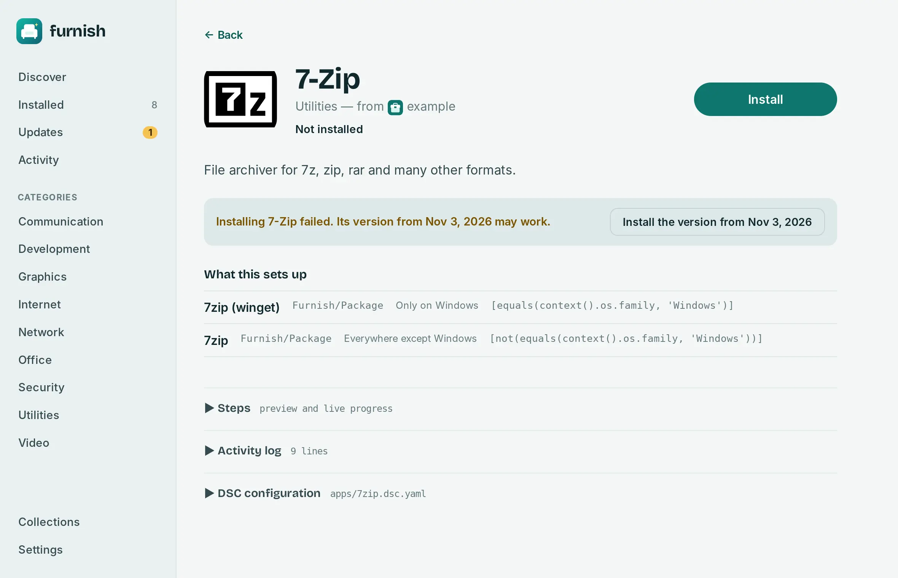

# Updates and recovery

## Updates

Furnish checks at launch and every 30 minutes by default. Open **Settings → Updates** to change the schedule or check now. The desktop must be running. On GNOME, install the AppIndicator extension to keep it running in the tray when you close the window.

- **Update all** queues every available app update, including apps with automatic updates turned off. Follow the queue in **Activity**.
- If a step needs another app to close, quit the named app, then select **Recheck and continue**. Independent items continue while the step is paused.
- Automatic updates can wait while the computer is busy. A required security update takes precedence over this setting and an app’s automatic-update preference.

## Review collection changes

Under **Collections**, open **Preview collection update** to compare the installed revision with the proposed one. Expand an app for added, changed and removed steps. **Other collection files** lists changes outside those steps. Choose **Apply reviewed revision** to accept the comparison. If either revision changed, refresh it first.

The update source selects a branch or release tag. See [collection tracking rules](collection-updates.md) if you maintain the collection.

## When an install fails

Open **Activity**, expand the failed step and read its output. **Retry** uses the current collection. For an **Update all** batch, **Retry failed** repeats just the failed apps.

If an earlier version is available, the app page offers the last version that worked on this computer, or the version before the latest change. Accepting it holds the app until the collection changes it again. **Try the current version** ends the hold immediately.



## Earlier versions of an app

Open **Versions** on the app page to install a specific day or commit. A version you choose explicitly stays selected until you change it. A required security update can override that selection. Your organization controls which versions are available.

```sh
furnish versions <app>
furnish install <app> --version <day-or-commit>
furnish install <app> --current
```

## Command-line tools installed with mise

If a tool requires mise, install mise and retry. Open a new terminal after Furnish adds the shims directory to your PATH. For a shell Furnish cannot configure, [enable mise shims](https://mise.jdx.dev/dev-tools/shims.html). Projects can select their own tool versions.
