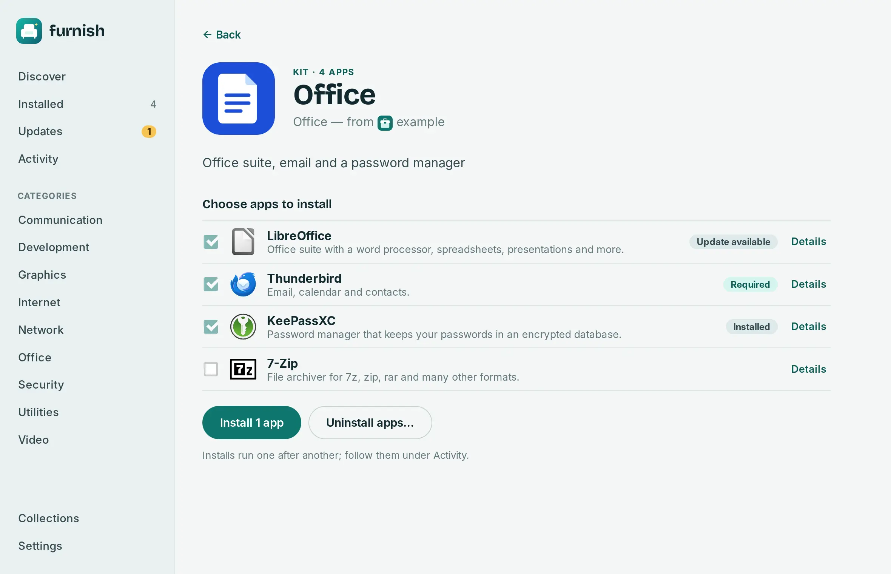

# Kits and catalog presentation

## Descriptions

App, kit and option descriptions support Markdown, including in translations. Use a YAML
literal block (`|`) to preserve paragraphs and lists. For example, in an app definition:

```yaml
metadata:
  furnish:
    description: |
      Configure **Acme VPN** before connecting.

      1. Open the VPN client.
      2. Select the profile shown below.

      
```

Place images relative to the collection root, or use an absolute HTTPS image URL.
Collection images can be PNG, JPEG, WebP or SVG, up to 8 MiB each. HTTPS links open in
the system browser. Cards and selection rows show compact formatted text, including image
alt text. Open an app or kit for the full description. Raw HTML is displayed as text.

## Icons

Apps set `metadata.furnish.icon`, kits and `collection.yaml` set `icon`: the path of an SVG, PNG, JPEG or WebP file in the repository. The collection's icon appears next to its name on the Collections page, on app cards and on app pages.

The app shows icons on its light or dark background as they are. For a logo that is hard to see in dark mode, such as dark lines without a background of their own, `iconDark` (`metadata.furnish.iconDark` for apps) names the image to show instead in dark mode. Many projects publish a version of their logo for dark backgrounds that fits:

```yaml
metadata:
  furnish:
    icon: icons/helm.svg
    iconDark: icons/helm-white.svg
```

## Kits

A kit installs several apps of the collection together:

```yaml
# kits/office.yaml
name: Office              # shown instead of the ID; optional
description: Office suite, email and a password manager
categories: [Office]
icon: icons/office.svg
items:
  - app: libreoffice
    required: true       # always installed with the kit
  - app: thunderbird
    required: true
  - app: keepassxc       # optional and preselected
  - app: 7zip
    selected: false      # optional, not preselected
```



## Questions and options

`collection.yaml` declares options that all of the collection's apps can use. An option marked `required` is a question: furnish asks it when the collection is added, and at each start until someone answers.

```yaml
icon: icons/collection.svg
parameters:
  role:
    type: string
    required: true
    label: What do you work on?
    allowedValues:
      - { value: developer, label: Software development }
      - { value: design, label: Design and media }
      - { value: office, label: Office work }
```

An option with `allowedValues` is shown as a list to choose from. An app uses an option by declaring it as a DSC parameter, then uses it in conditions and properties. furnish takes an option's value from the first of these that sets it: a locked value in the admin policy, the user's value for the app, the policy's default for the app, the user's value for the collection, the policy's default for the collection, the default in `collection.yaml`, the app's own default. A value is used as it is: text that starts with `[` is not evaluated as a DSC expression, except the app's own default.

For a folder path, add `folder: true` to a string option in `collection.yaml`:

```yaml
parameters:
  location:
    type: string
    folder: true
    label: Team documents folder
```

Apps that declare the same parameter inherit the folder picker. For an app-specific option, set the hint in its DSC parameter metadata:

```yaml
parameters:
  location:
    type: string
    metadata: { furnish: { folder: true, label: Team documents folder } }
    defaultValue: "[concat(variables('furnish.host').documentsDir, '/Team docs')]"
```

Set `metadata.furnish.label` on any app parameter to give it a display name in the collection’s own language. The desktop and `furnish option list` use it, and the parameter name stays the same for CLI commands and translations.

For folder options the desktop offers a text field and a system folder chooser. The chooser starts at the current or inherited path, using the closest existing folder for a new destination. The CLI still accepts a path as text. Options with `allowedValues` keep their list of choices.

## Recommendations

```yaml
metadata:
  furnish:
    recommended: "[equals(parameters('role'), 'office')]"   # or: true
```

Recommended kits appear alongside recommended apps at the top of Discover. In a kit file, put `recommended` at the top level. Use `true` to recommend it to everyone, or use an expression such as `"[equals(parameters('role'), 'office')]"` to recommend it based on collection options. App expressions can also use the app's own options.

## Translations

A collection can translate its texts into any language. Each language has one file, `locales/<lang>.yaml`, named with a language tag such as `de`, `fr` or `pt-BR`:

```yaml
# locales/de.yaml
categories:                # a category as the apps write it, and its name
  Office: Büro
apps:
  thunderbird:             # the app's ID
    name: Thunderbird
    description: E-Mail, Kalender und Kontakte.
kits:
  office:
    name: Büro
    description: Office-Paket, E-Mail und Passwortmanager
parameters:                # options and questions of collection.yaml and of the apps
  role:
    label: Woran arbeitest du?
    description: Empfiehlt die Apps für deine Rolle.
    allowedValues: { developer: Softwareentwicklung, design: Design und Medien, office: Büroarbeit }
```

Every entry is optional. The texts in the app files, kit files and `collection.yaml` are in English unless `collection.yaml` names another language, for example `language: de`.

For each text, furnish shows the first of these that exists:

1. the translation into the app's language, the one set under Language or the system's,
2. the translation into the fallback language, English unless people or the policy choose another,
3. the text as written in the collection.

A translation file for `pt` also serves people who use `pt-BR`, and the other way round. If the app's language or the fallback language is the collection's own `language`, furnish shows the collection's texts. A collection written in German with `language: de` shows its texts to German speakers, and to everyone else when it has no translation for them.

The sidebar lists each category once, even if several collections use it. If they translate it differently, the sidebar uses the translation of the first collection in alphabetical order. Search looks at the texts in the app's language, in the fallback language and as written in the collection, so an English word finds an app on a German screen. Reports and logs use IDs, and so do commands such as `furnish install`. `furnish list` shows the IDs with the translated texts.
