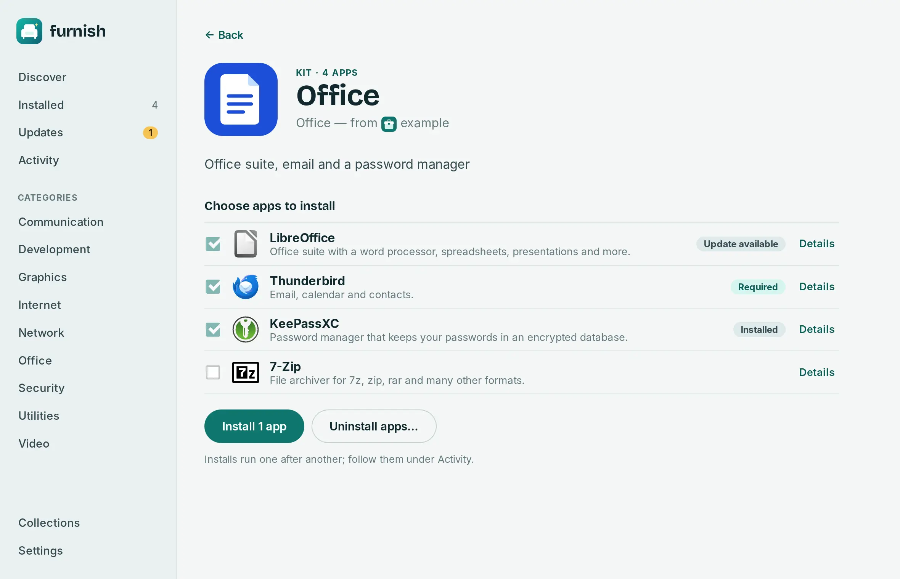
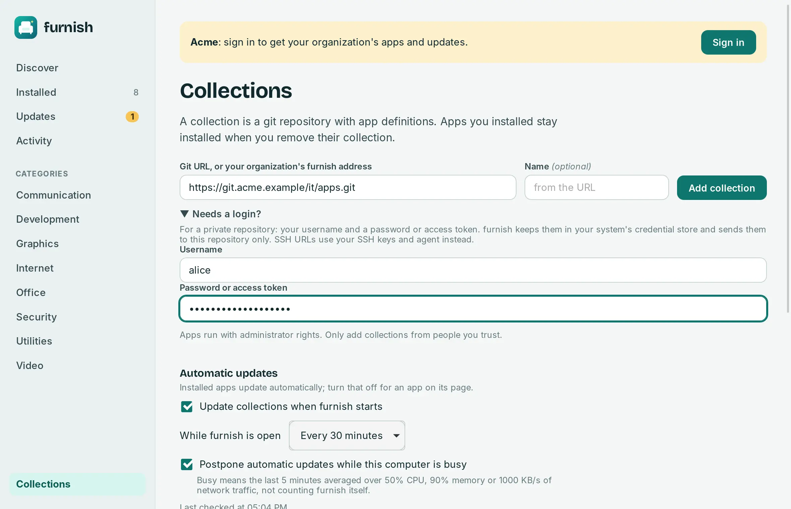

# Writing a collection

A collection is a git repository with this layout:

```
collection.yaml          # the collection's icon and the questions it asks
apps/<app>.dsc.yaml      # one file per app
kits/<kit>.yaml          # apps that are installed together
icons/                   # images the files above refer to
```

furnish clones the repository for each user and pulls changes at start and every 30 minutes. It downloads the history's commits, but file contents only for the current version; earlier versions and installer files come when they are needed. The [example collection](https://github.com/furnish-self-service/self-service-example) uses everything on this page with real apps.

## Apps

An app is a [DSC v3](https://learn.microsoft.com/powershell/dsc/overview) configuration document. Its file name without `.dsc.yaml` is the app's name. furnish shows what `metadata.furnish` says in the catalog and runs `resources` to install the app:

```yaml
metadata:
  furnish:
    description: Image editor for photo retouching, image composition and painting.
    categories: [Graphics, Photo]
    icon: icons/gimp.svg
resources:
  - name: GIMP
    type: Furnish/Package
    condition: "[not(equals(context().os.family, 'Windows'))]"
    properties:
      name: gimp
  - name: GIMP (winget)
    type: Furnish/Package
    condition: "[equals(context().os.family, 'Windows')]"
    properties:
      name: GIMP.GIMP.3
```

furnish skips a resource whose `condition` is false, and hides an app that has no resource for the system. To uninstall, it runs the same resources in reverse order with `_exist: false`.

### Furnish/Package

Installs a package with the system's package manager: the first of pacman, apt, dnf, zypper, brew and nix that is installed, and winget on Windows.

| Property | Meaning |
|---|---|
| `name` | The package's name |
| `packageManager` | Use this package manager, not the first one found |
| `pacmanName`, `aptName`, `dnfName`, `zypperName`, `brewName`, `nixName` | The package's name with that package manager, if it differs, for example `pacmanName: libreoffice-fresh` |
| `nixpkgs` | The flake to install Nix packages from (default: the registry's `nixpkgs`) |

### Furnish/Installer

Installs a file from the collection: `.deb`, `.rpm`, `.pkg`, `.dmg`, `.msi` or `.exe`. furnish downloads the file when someone installs an app that uses it, so a computer only stores the installers of its own apps. Git LFS works too and keeps large files out of the repository's history.

```yaml
- name: Company VPN
  type: Furnish/Installer
  properties:
    file: installers/vpn.msi
```

### Dependencies

An app can depend on other apps of its collection. furnish installs required dependencies first. Optional ones are preselected, and people can deselect them when they install the app.

```yaml
metadata:
  furnish:
    dependencies:
      - app: homebrew
        required: true
      - app: fonts
```

If a resource needs a tool that is missing, such as Homebrew on a Mac, the app shows "Needs Homebrew" instead of an Install button. A dependency can install the tool.

## Icons

Apps set `metadata.furnish.icon`, kits and `collection.yaml` set `icon`: the path of an SVG, PNG, JPEG or WebP file in the repository. The collection's icon appears next to its name on the Collections page, on app cards and on app pages.

## Kits

A kit installs several apps of the collection together:

```yaml
# kits/design-studio.yaml
description: Image editing, vector graphics and digital painting
categories: [Graphics]
icon: icons/design-studio.svg
items:
  - app: gimp
    required: true       # always installed with the kit
  - app: inkscape
    required: true
  - app: krita           # optional and preselected; `selected: false` leaves it unselected
```



## Questions and options

`collection.yaml` declares options that all of the collection's apps can use. An option marked `required` is a question: furnish asks it when the collection is added, and at each start until someone answers.

```yaml
icon: icons/collection.svg
parameters:
  role:
    type: string
    required: true
    label: What do you work on?
    allowedValues:
      - { value: developer, label: Software development }
      - { value: design, label: Design and media }
      - { value: office, label: Office work }
```

An option with `allowedValues` is shown as a list to choose from. An app uses an option by declaring it as a DSC parameter, then uses it in conditions and properties. furnish takes an option's value from the first of these that sets it: a locked value in the admin policy, the user's value for the app, the policy's default for the app, the user's value for the collection, the policy's default for the collection, the default in `collection.yaml`, the app's own default.

## Recommendations

```yaml
metadata:
  furnish:
    recommended: "[equals(parameters('role'), 'design')]"   # or: true
```

Recommended apps appear first on Discover. The expression can use the collection's options and the app's own.

## Private repositories

A collection can be a private repository:

- Over HTTPS, furnish asks for a username and a password or access token when the server requires one, keeps them in the system's credential store, and sends them to that repository only. On the command line: `furnish collection add <url> --username alice`, which asks for the password, or `--password-stdin` for scripts.
- Over SSH, furnish uses git as it is set up: your keys, `ssh-agent` and `~/.ssh/config`. Connect to the server once with `ssh` to accept its host key.

git's own credential helpers and credentials in the URL also work.


