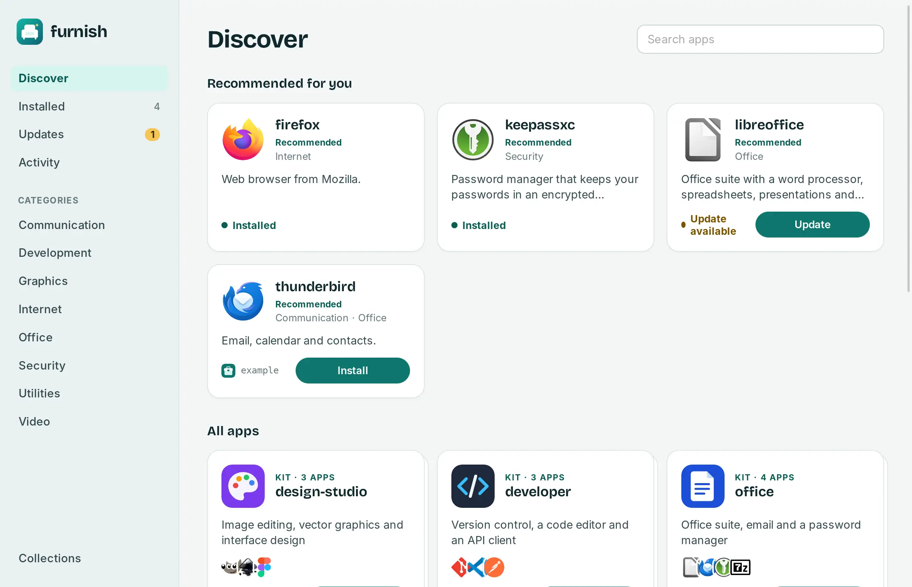

# Get started

furnish is an app catalog for an organization's computers. People pick an app and click Install; furnish installs it with the system's package manager on Windows, macOS or Linux, and keeps it updated.

The catalog is a git repository, called a collection. Each app in it is a short configuration file in [DSC](https://learn.microsoft.com/powershell/dsc/overview), Microsoft's open-source format for describing what a computer should have installed.



## Install furnish

The downloads below follow the stable channel once v0.1.0 is published. The [releases page](https://github.com/furnish-self-service/furnish/releases) lists available installers, including alpha builds for people testing upcoming changes.

| System | How |
|---|---|
| Windows, 64-bit | [download](https://furnish-self-service.github.io/furnish/stable/furnish-windows.msi) |
| macOS with Apple silicon | Homebrew, below, or [download](https://furnish-self-service.github.io/furnish/stable/furnish-macos.dmg) |
| Linux | the signed package repository, below |
| Intel Macs, other systems | build from source, below |

On macOS, Homebrew installs the desktop app and the `furnish` command, and `brew upgrade` brings stable updates:

```sh
brew install --cask furnish-self-service/tap/furnish
```

The Windows and macOS builds aren't signed with a publisher certificate. On Windows, choose More info → Run anyway when SmartScreen warns. On macOS, open furnish from Applications once, then allow it under System Settings → Privacy & Security → Open Anyway. Do this before you use the `furnish` command. macOS may ask again after an update.

How new versions of furnish arrive depends on how you installed it:

| Installed with | New versions |
|---|---|
| the Windows download | furnish installs them itself |
| the macOS download | furnish installs them itself |
| Homebrew | `brew upgrade` |
| the Linux package repository | your system updates |
| Nix | `nix flake update` |

When furnish installs a version itself, it checks the download's signature first. It restarts into the new version once nothing is installing and its window is closed. Settings → About shows how furnish was installed and whether a new version is out. See [New versions of furnish](using.md#new-versions-of-furnish).

`brew uninstall --cask furnish` keeps your settings and collections. Add `--zap` to remove them too.

Furnish requires Git and Git LFS for collection checkouts. The Linux DEB and RPM packages install both as dependencies, and the Nix packages provide both. When using the standalone Linux CLI or building from source, install both tools and check `git lfs version`. The Windows installer includes it ([MinGit](https://github.com/git-for-windows/git/wiki/MinGit) with Git LFS); Furnish uses an installed Git first when it also provides Git LFS. The macOS app includes Git LFS. Git itself comes with Apple's Command Line Tools: if they are missing, macOS offers to install them the first time furnish adds a collection, or run `xcode-select --install`.

On Linux, furnish comes from a signed package repository, so updates arrive with the system's other updates. The package contains the desktop app and the `furnish` command, and brings git along. On Debian, Ubuntu and their derivatives:

```sh
sudo install -d /etc/apt/keyrings
sudo curl -fsSLo /etc/apt/keyrings/furnish.asc https://furnish-self-service.github.io/furnish/gpg-key.asc
sudo curl -fsSLo /etc/apt/sources.list.d/furnish.list https://furnish-self-service.github.io/furnish/stable/furnish.list
sudo apt update && sudo apt install furnish
```

On Fedora and Enterprise Linux 10, save `https://furnish-self-service.github.io/furnish/stable/furnish.repo` in `/etc/yum.repos.d/` and run `sudo dnf install furnish` (on Enterprise Linux 10, enable EPEL and CRB first). On openSUSE, run `sudo zypper addrepo` with the same URL, then `sudo zypper install furnish`. On NixOS, use the flake's NixOS module and add its binary cache `furnish.cachix.org` to `nix.settings`, or Nix builds furnish from source on every update; see [For admins](admins.md#nixos).

To build from source you need git, Rust 1.91 or later and, for the desktop app, Node.js and on Linux WebKitGTK 4.1:

```sh
git clone https://github.com/furnish-self-service/furnish.git && cd furnish
cargo install --path .                    # the furnish command
cd gui && npm ci && npm run bundle        # the desktop app's installers, in target/release/bundle/
```

### Switching from alpha to stable

Windows MSI and macOS disk-image installations follow the channel of the installed build. Install the stable download once to switch. If Windows reports a newer version is already installed, uninstall the alpha MSI through Installed apps first. On macOS quit Furnish before replacing the app in Applications. Keep your Furnish data folder to retain collections and settings.

For Homebrew, run `brew update` and `brew reinstall --cask furnish-self-service/tap/furnish`. For Linux, replace the alpha repository with the stable repository above. A package manager may rank `0.1.0+alpha.N` above `0.1.0`. On Debian or Ubuntu, run `sudo apt update` and `sudo apt install --allow-downgrades furnish=0.1.0`. On Fedora, refresh metadata and use `sudo dnf downgrade furnish-0.1.0` if an ordinary upgrade retains the alpha. Run `furnish --version` to confirm.

### Terminal command for the macOS download

Drag `furnish.app` from the disk image into Applications and open it there. In **Settings → About → Terminal command**, choose **Install**. Enter an administrator password if macOS asks, then run `furnish --version` in Terminal. The link at `/usr/local/bin/furnish` follows the app across updates. When uninstalling the app, you can remove its link with `sudo rm /usr/local/bin/furnish` after confirming that `readlink /usr/local/bin/furnish` still points into the app.

## Add a collection

In the app, open Collections and enter one of these:

- your organization's furnish address, such as `furnish.myorg.tld`, if it has one. You sign in with your organization's account in the browser, and furnish adds its collections.
- a collection's git URL, for example the example collection with a dozen real apps: `https://github.com/furnish-self-service/self-service-example.git`

The command line takes the same input:

```sh
furnish collection add https://github.com/furnish-self-service/self-service-example.git
```

The example collection asks what you work on and recommends apps for the answer. Pick an app on Discover and click Install.

## Next

- [Using the app](using.md): installing, the queue, updates and options.
- [Writing a collection](collections.md): a catalog for your organization.
- [For admins](admins.md): presetting collections, locking settings, branding, sign-in without VPN, and installs for people without administrator rights.
