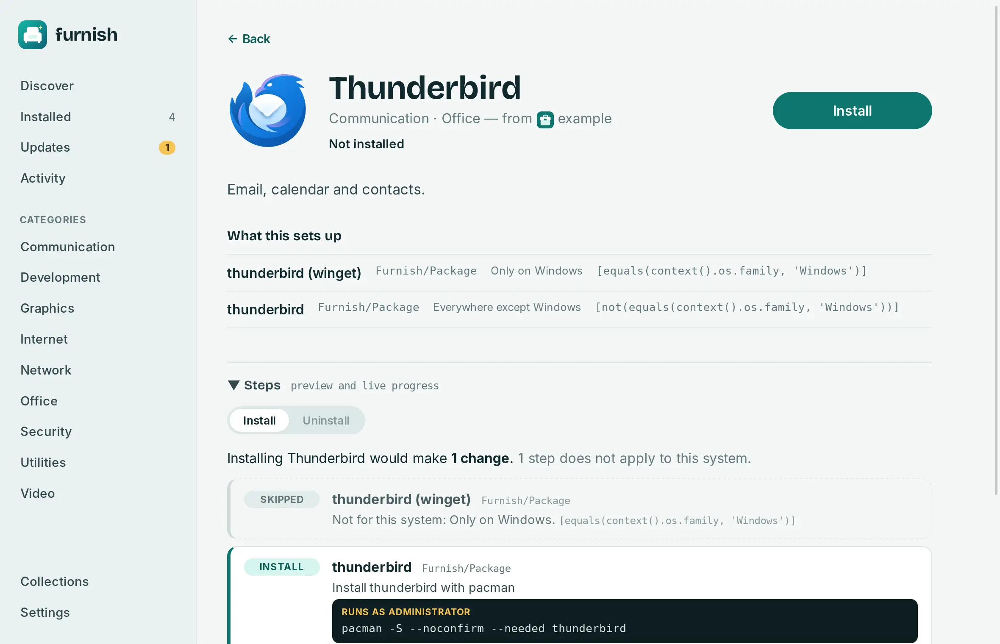

# Using the app

## Find an app

Discover lists what your collections offer, starting with the apps they recommend for you. Installed and Updates narrow the list to installed apps and to apps with an update. The categories in the sidebar filter by topic, and the search box matches names and descriptions.

A collection can ask a question when you add it, for example what you work on. furnish asks again at each start until you answer. Later closes the dialog; until you answer, the collection's apps show Answer first instead of Install.

## Sign in to your organization

If your organization has a furnish address, furnish signs you in with your organization's account in the browser. When that sign-in expires, a banner asks you to sign in again; until then furnish can't fetch new apps or updates from your organization.

## An app's page

Click an app for its description, its source and what it installs. Three closed sections show details:

- Steps lists what installing or uninstalling would do: each step, the exact command, and whether it needs administrator rights. Nothing changes until you click Install.
- Activity log shows what the package manager printed during the last install.
- DSC configuration shows the app's file in the collection.

## Install, update, uninstall

While an app installs, its button shows the progress and a stop control. The first click stops after the current step; a second click stops the current step too. With Steps open, you see each step's start time, duration and result.

If a step needs administrator rights, your system asks for your password. Cancelling the password dialog cancels the install.

Installs run one at a time. Clicking Install on more apps adds them to a queue, which the Activity page shows; ✕ removes an app from it.

## Updates

furnish checks for updates when it starts and every 30 minutes, and installs them. It waits while the computer is busy: when the last 5 minutes averaged over 50% CPU, 90% memory or 1000 KB/s network traffic, not counting furnish's own work. You can turn automatic updates off for one app on its page, and change the schedule or the busy check on the Collections page.

## Options

Some apps can be installed in more than one way, for example for all users or only for you. An app's page shows its options; the Collections page shows the options that apply to all apps of a collection. Your organization may set some of them. If you change an option of an installed app, its page offers Reinstall with these options.

