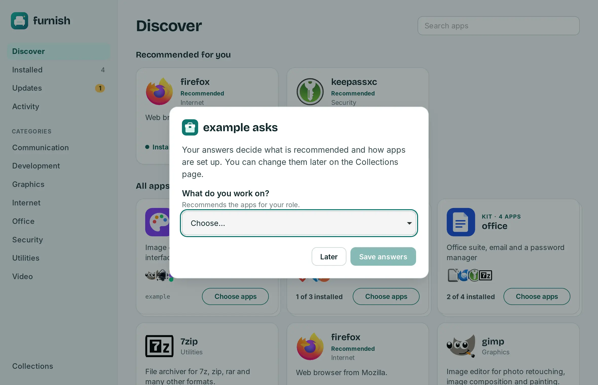
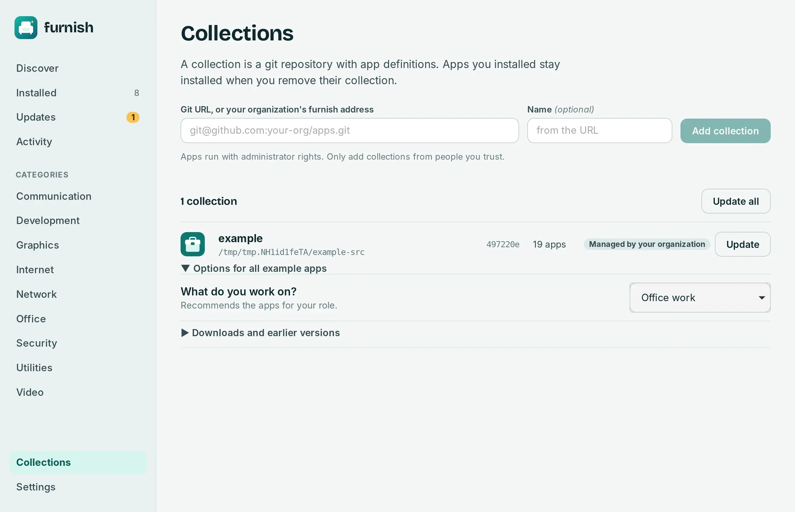

# Using the app

## Find an app

**Discover** shows everything your collections offer, starting with what they recommend for you. **Installed** and **Updates** filter the catalog, the categories in the sidebar narrow it, and the search box finds apps by name or description.

When a collection asks a question, for example what you work on, the app asks right after you add it and at each start until you answer. **Later** postpones it; until then, the collection's apps show **Answer first** instead of **Install**.

## An app's page

Click an app to see what it is, where it comes from and what it sets up. Three collapsed sections are there for the curious:

- **Steps** previews installing or uninstalling: each step, the exact command and whether it needs administrator rights. Nothing changes until you click Install.
- **Activity log** shows what the package manager printed during the last install.
- **DSC configuration** shows the app's file from the collection.

## Install, update, uninstall

While an app installs, its button turns into a progress indicator with a stop control. The first click stops after the current step, the second interrupts it. With **Steps** open, you follow each step live, with its start time, duration and result.

If a step needs administrator rights, your system asks for the password. Cancelling that dialog cancels the install; nothing breaks.

Clicking Install on several apps queues them: one runs at a time. The **Activity** page shows what runs and what waits; ✕ removes an app from the queue.

## Updates

furnish checks for updates when it starts and every 30 minutes, and installs them by itself. It waits while the computer is busy: over 50% CPU, 90% memory or 1000 KB/s network on average over 5 minutes, not counting furnish's own work. Turn automatic updates off for one app on its page, or change the schedule and the load check on the **Collections** page.

## Options

Some apps can be set up in more than one way, for example system-wide or only for you. Their page shows the options; the Collections page shows options that apply to all of a collection's apps. Your organization may set some of them for you. Changing an option of an installed app offers **Reinstall with these options**.

