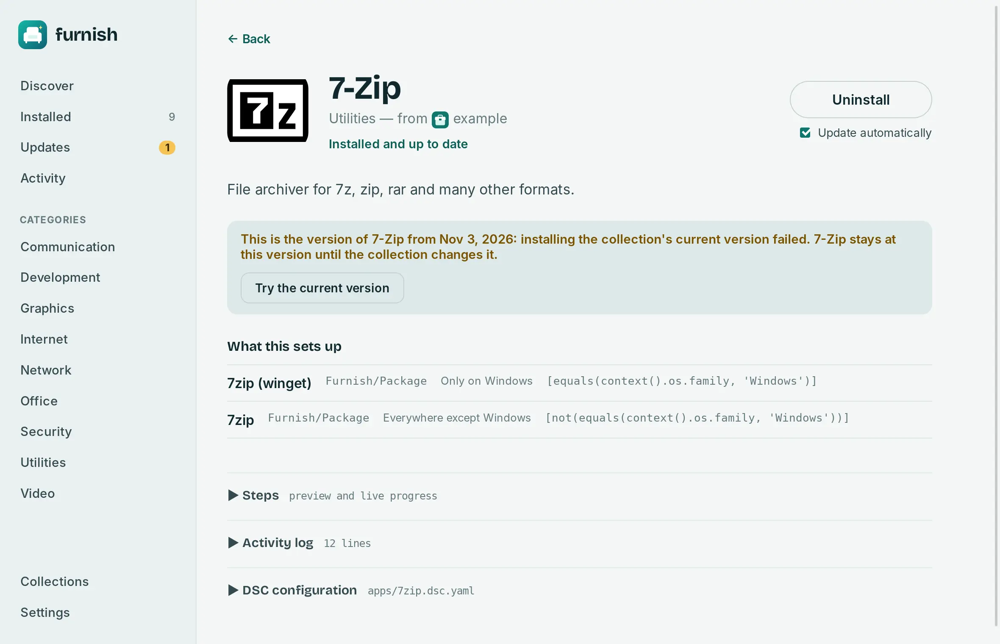
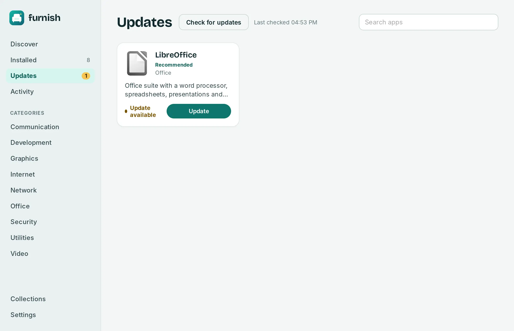

# Using the app

## Find an app

Discover lists what your collections offer, starting with the apps they recommend for you. Installed and Updates narrow the list to installed apps and to apps with an update. The categories in the sidebar filter by topic. The search box matches names, descriptions and categories. It ignores accents and case, so "buro" finds "Büro", and it also finds texts in the fallback language.

A collection can ask a question when you add it, for example what you work on. furnish asks again at each start until you answer. Later closes the dialog; until you answer, the collection's apps show Answer first instead of Install.

## Sign in to your organization

If your organization has a furnish address, furnish signs you in with your organization's account in the browser. When that sign-in expires, a banner asks you to sign in again; until then furnish can't fetch new apps or updates from your organization.

When your organization adds a collection to its address, furnish adds it the next time it updates the collections. A collection you removed stays removed; to get it back, add the address again.

## An app's page

Click an app for its description, its source and what it sets up on this computer. Closed sections show details:

- Versions lists the app's versions from the collection's history, with the day of each. Install next to one installs that version (see [Earlier versions of an app](#earlier-versions-of-an-app)).
- **Steps** previews the commands an install or uninstall would run and whether they need administrator rights. For a package, it shows which manager and package name furnish chose on this computer and why. When a condition skips a step, its explanation appears above the original DSC expression. You can select and copy the expression.
- Activity log shows what the package manager printed during the last install.
- DSC configuration shows the app's file in the collection.

## Install, update, uninstall

While an app installs, its button shows the progress and a stop control. The first click stops after the current step; a second click stops the current step too. With Steps open, you see each step's start time, duration and result.

If a step needs administrator rights, your system asks for your password. Cancelling the password dialog cancels the install.

Some apps can't be uninstalled with furnish, for example a setting the collection doesn't say how to remove. Their page shows a note instead of the Uninstall button.

Apps you installed without furnish, for example with npm or the vendor's installer, can show as installed outside furnish. furnish doesn't install them a second time, update them or uninstall them; the app's page shows where the program is. Uninstall such an app with what installed it.

On NixOS, apps from your NixOS or Home Manager configuration show as installed via that configuration. furnish doesn't install, update or uninstall them. To remove one, delete its package from your configuration; the app's page shows which one. Some apps go into your NixOS configuration: furnish adds them there, rebuilds the system and commits `flake.lock` for you. Your administrator sets this up. If you use Home Manager with furnish's Home Manager module, these apps go into your Home Manager configuration instead, and furnish activates the new generation for you. The Settings page shows the lines your configuration needs for this, and where apps go. You can choose the NixOS configuration or Home Manager there, or with `furnish settings --nixos-install-into system` or `home`.

If your NixOS configuration sets `services.furnish.nix.configuration`, furnish uses that folder. Otherwise it looks in the usual places, such as `/etc/nixos` or nh's `NH_FLAKE`. The NixOS section of the Settings page shows what it found and how. If it found nothing, or the wrong folder, enter your configuration's folder there, or pick one of the suggested folders. You can also set the name in the flake if it isn't your computer's name. "Find it automatically" goes back to searching. In the terminal: `furnish settings --nixos-configuration ~/nixos-config`, `--nixos-flake-attribute <name>` and `--nixos-reset`.

Installs run one at a time. **Activity** shows the current operation and the queue. Expand **Steps** to follow an app while it runs, or use ✕ to remove a waiting app from the queue.

## When an install fails

Open **Activity** to see which step failed and the collection revision used. The failure summary survives a restart. **Retry** checks the app and its prerequisites again using the current collection.

If installing or updating an app fails, furnish offers an earlier version of it: the one that last installed on this computer, else the version before the collection's latest change to the app. The app's page shows Install the version from, with the day of that version.

furnish then keeps the app at that version, and its updates don't retry the failed one. When the collection changes the app again, furnish installs the new version with the next update. Try the current version on the app's page installs the collection's version right away.

On the Collections page, Downloads and earlier versions sets this per collection: offer the previous version, install it without asking, or neither, and how much older it may be. Your organization may set these.

## Command-line tools installed with mise

A collection can use mise to install tools for your account. If an app shows that it needs mise, install mise and retry. Furnish checks the active global tool version and available releases when it checks the app for updates. The app's steps preview shows the selected manager and tool ID.

Use the installed command directly in a terminal. If Furnish adds the mise shims directory to your shell or Windows user PATH, open a new terminal from the desktop to pick up the change. Furnish can set up Bash, Zsh, Fish and POSIX login shells. For another shell or a read-only shell profile, enable mise activation or add its shims directory to PATH yourself. A project with its own mise configuration can still select a different tool version. [How mise shims work](https://mise.jdx.dev/dev-tools/shims.html)

## Earlier versions of an app

The Versions section of an app's page lists the versions of the app in the collection's history, newest first: the day of each, the versions of the program the collection's file accepted then, and which one is installed. Install next to a version installs it. furnish then keeps the app at that version until you choose another one, also when the collection changes the app. The app's page says when a newer version is available, and Install the current version goes back to the collection's version. In the terminal: `furnish versions <app>` and `furnish install <app> --version <day or commit>`.

The list holds only versions your organization allows: within the history furnish keeps, not older than the limit for earlier versions, signed where your organization requires it, and with a version of the program the collection still accepts. If the collection requires a newer version for security reasons, furnish installs it even for an app at a version you chose. Your organization can turn choosing a version off; Choosing a version on the Collections page shows whether it is allowed.

## Updates

furnish checks for updates when it starts and every 30 minutes, and installs them. It waits while the computer is busy: when the last 5 minutes averaged over 50% CPU, 90% memory or 1000 KB/s network traffic, not counting furnish's own work. You can turn automatic updates off for one app on its page, and change the schedule or the busy check on the Settings page. Check now there looks for updates right away.

On the Updates page, choose **Update all** to queue every available app update, including apps with automatic updates turned off. Open the **Update all** entry in **Activity** for the batch progress, then expand an app’s steps for details. If some updates fail, **Retry failed** retries those apps in the same group.

When Furnish can inspect the settings from your account, the app card names any running application that needs to close. For settings only the service can read, Activity names the application when the service checks the request. You can still choose **Install** or **Update all**. Furnish pauses the affected item before its first step and continues with independent work. Quit the named applications, then select **Recheck and continue** in **Activity**. The paused request and the apps waiting for it remain available after restarting Furnish.

Your organization can require a version of an app, for example after a security fix. When yours is older, the app shows Security update required and furnish installs the update right away, also if automatic updates are off for the app or the computer is busy. If no acceptable version is available yet, the app says which version it needs and which one is offered.

Updates only run while furnish runs. So furnish starts when you sign in, with its window closed, and waits in the system tray on Windows and Linux or in the menu bar on macOS. Closing the window keeps it running there. Its icon, or your organization's, opens the window, checks for updates or quits furnish. Quitting waits for an install that is running. To stop starting furnish at sign-in, turn off Start furnish when you sign in on the Settings page. The tray menu's Settings… opens that page.

Open **Collections** and expand a collection’s update source to choose the remote default branch, another branch, or release tags with names matching a regular expression. For example, `^v[0-9]+[.][0-9]+[.][0-9]+$` follows stable version tags. Choose the highest matching version, or choose the newest by date if a newly tagged maintenance release should take precedence. Saving checks the rule against the repository and applies the selected revision. The control shows who selected the rule and whether your organization has locked it.

Expand **Preview collection update** to compare the checkout with the release its update source selects. The comparison shows both commits and their advertised Git tags. For each affected app, it lists added, removed and changed steps, including explicit uninstall steps. **Recorded as installed** identifies apps Furnish has installed. A held app’s entry compares the two collection releases even when that app uses an earlier version.

The comparison uses the declarations and directly referenced installer, command and configuration files. Conditions, chosen options and shared files can affect which steps run. Expand **Other collection files** to see additional paths that changed. **Apply reviewed revision** checks both commits again before updating the collection. If either moved, refresh the comparison to see the new changes.

When a collection has changed on its server but furnish hasn't brought the change in yet, for example between checks or because checking is turned off, the sidebar shows a count next to Collections, and the Collections page marks the collection with Update available. Its Update button brings the change in. furnish only asks the server for its newest commit for this, without downloading or changing anything, and shows nothing while it is offline. With checking set to Never and When furnish starts turned off, furnish doesn't contact the servers on its own, and the mark only changes after Check now or Update.

On GNOME, tray icons only show with the AppIndicator extension. Without a tray, closing the window quits furnish. If furnish started at sign-in, open it from the app list to see its window.

## New versions of furnish

Settings → **About** shows the version of the running desktop, including the alpha number for published releases. Expand **Build details** to see the build target and, when available, the source commit and date.

**Update channel** shows whether Furnish follows **Stable** or **Alpha**. On the Windows all-users MSI, downloaded macOS app and Linux current-user archive (v0.2.0 onward), select either channel in About, or run `furnish settings --update-channel stable` or `--update-channel alpha`. The selected feed can offer an older version when switching channels. Your update mode still applies. With **Only tell me**, select **Update now** when ready. With checks turned off, the preference is saved until checks resume.

For package-managed and manual installs, About shows the channel of the installed build and instructions for changing the package source. The Homebrew cask follows stable. To use alpha on macOS, uninstall the cask without `--zap` and install the alpha disk image. For Linux packages, change the repository between `/stable/` and `/alpha/`. For Nix, change the Furnish flake input between a release tag and the main branch and rebuild.

The **Data folder** row opens Furnish’s local data in your file manager. On NixOS, Settings also shows the configuration folder and the generated flake under **Generated NixOS files**. Standalone Home Manager shows its own generated folder, including a custom path configured in the flake input. Choose **Open folder** next to the path to inspect its files.

When a package manager replaces the desktop while it is open, Furnish offers to restart into the installed version. The offer appears once the queue is empty and active work has finished, including updates paused in Activity. Choose **Restart** to launch the installed build. This also works when a package manager rolls back a version. For a portable AppImage, automatic detection requires a FUSE-mounted image and the system’s `unsquashfs` tool. If Furnish cannot identify the replacement, quit and reopen the AppImage.

When a new version of furnish is out, a dot appears next to Settings in the sidebar, and Settings → About names the version. furnish looks for one whenever it looks for app updates. Offline, it shows nothing.

If you installed furnish from the all-users Windows MSI, macOS app download or Linux current-user archive (v0.2.0 onward), furnish downloads the new version and checks its signature. It installs the version and restarts once nothing is installing and its window is closed. To do it right away, choose Restart to update in About or in the tray menu. furnish waits for an install that is running. On Windows, the installer may ask for administrator rights.

Homebrew installations receive new versions with `brew upgrade`, and Linux repository packages receive them with system updates. Nix installations follow the flake input. Update it with `nix flake update` and rebuild your configuration. Furnish skips release-feed checks for these Nix installations.

New versions of furnish, also in About, sets what furnish does: install them, only tell you, or not check. With Only tell me, Update now in About installs the version. Your organization may set this. On the command line, `furnish self-update` installs the new version and `furnish settings` shows how furnish was installed.

## Options

Some apps can be installed in more than one way, for example for all users or only for you. An app's page shows its options; the Collections page shows the options that apply to all apps of a collection. Your organization may set some of them. If you change an option of an installed app, its page offers Reinstall with these options.

## Language

furnish is available in English, German, French, Spanish, Italian, Polish, Portuguese and Dutch. It follows the system language; Language on the Settings page sets one of them instead. For any other system language it uses English.

Collections can translate their app names, descriptions, categories and questions. furnish shows them in its own language if the collection has that translation. Otherwise it uses the fallback language, which you choose under Fallback language on the Settings page. It is English unless your organization sets another. Texts that exist in neither language appear as the collection wrote them.

