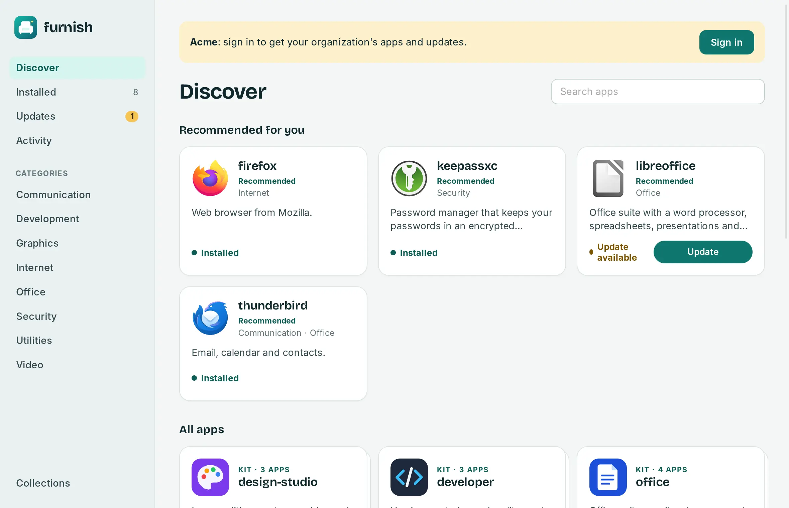
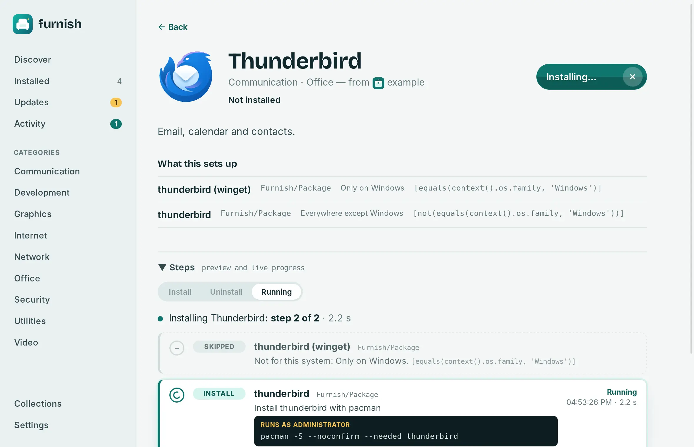
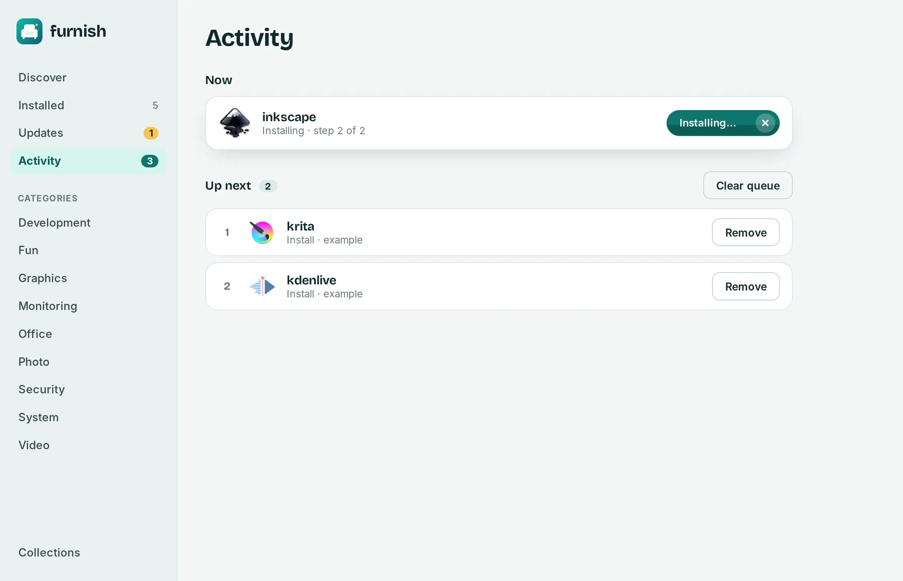
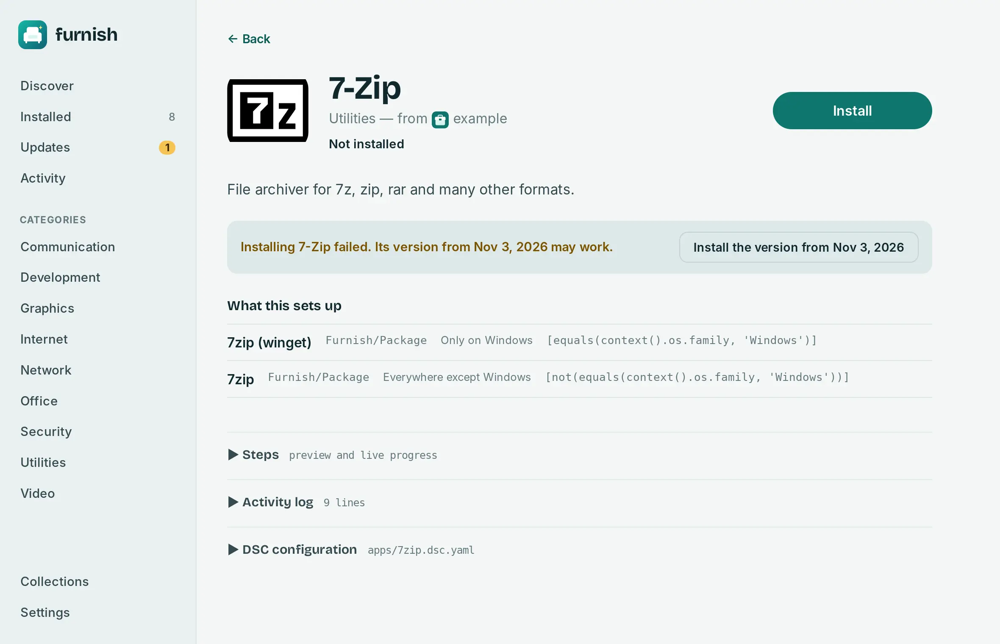
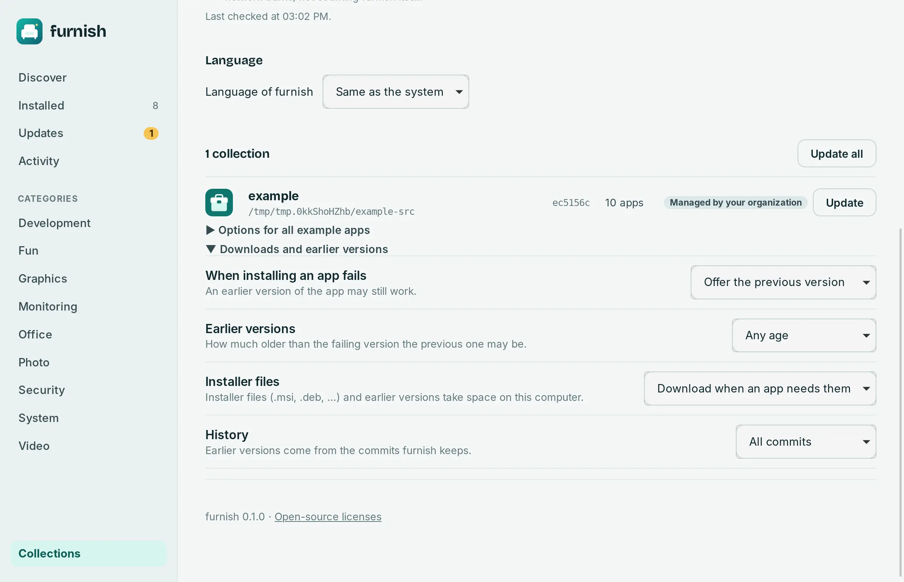
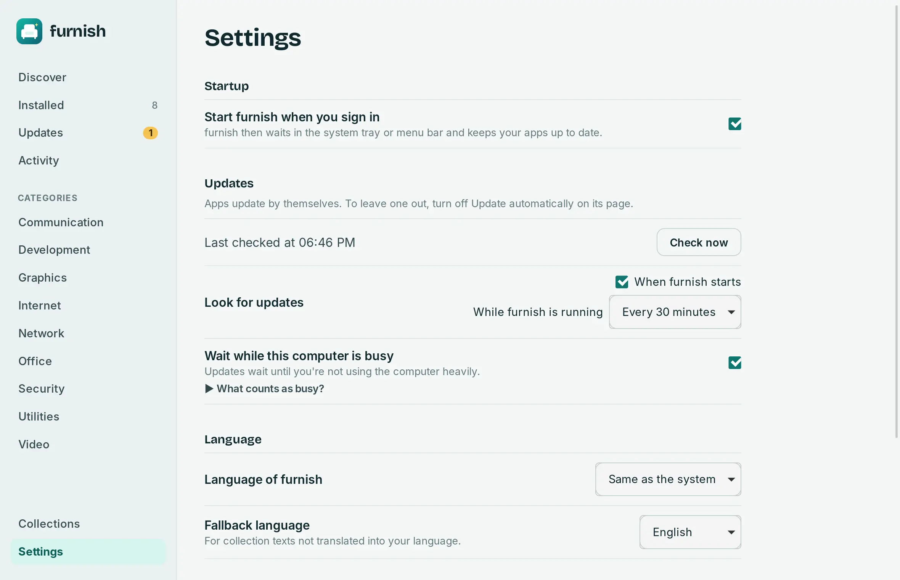
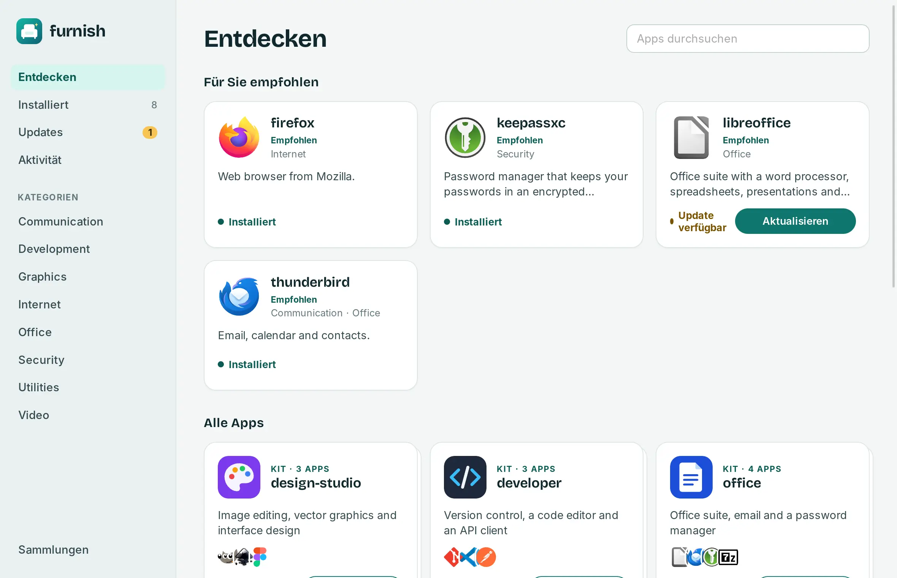

# Using the app

## Find an app

Discover lists what your collections offer, starting with the apps they recommend for you. Installed and Updates narrow the list to installed apps and to apps with an update. The categories in the sidebar filter by topic. The search box matches names, descriptions and categories. It ignores accents and case, so "buro" finds "Büro", and it also finds texts in the fallback language.

A collection can ask a question when you add it, for example what you work on. furnish asks again at each start until you answer. Later closes the dialog; until you answer, the collection's apps show Answer first instead of Install.

## Sign in to your organization

If your organization has a furnish address, furnish signs you in with your organization's account in the browser. When that sign-in expires, a banner asks you to sign in again; until then furnish can't fetch new apps or updates from your organization.

## An app's page

Click an app for its description, its source and what it sets up on this computer. Three closed sections show details:

- Steps lists what installing or uninstalling would do: each step, the exact command, and whether it needs administrator rights. Nothing changes until you click Install.
- Activity log shows what the package manager printed during the last install.
- DSC configuration shows the app's file in the collection.

## Install, update, uninstall

While an app installs, its button shows the progress and a stop control. The first click stops after the current step; a second click stops the current step too. With Steps open, you see each step's start time, duration and result.

If a step needs administrator rights, your system asks for your password. Cancelling the password dialog cancels the install.

Some apps can't be uninstalled with furnish, for example a setting the collection doesn't say how to remove. Their page shows a note instead of the Uninstall button.

On NixOS, apps from your NixOS or Home Manager configuration show as installed via that configuration. furnish doesn't install, update or uninstall them. To remove one, delete its package from your configuration; the app's page shows which one.

furnish looks for your NixOS configuration in the usual places, such as `/etc/nixos` or nh's `NH_FLAKE`. The NixOS section of the Settings page shows what it found and how. If it found nothing, or the wrong folder, enter your configuration's folder there, or pick one of the suggested folders. You can also set the name in the flake if it isn't your computer's name. "Find it automatically" goes back to searching. In the terminal: `furnish settings --nixos-configuration ~/nixos-config`, `--nixos-flake-attribute <name>` and `--nixos-reset`.

Installs run one at a time. Clicking Install on more apps adds them to a queue, which the Activity page shows; ✕ removes an app from it.

## When an install fails

If installing or updating an app fails, furnish offers an earlier version of it: the one that last installed on this computer, else the version before the collection's latest change to the app. The app's page shows Install the version from, with the day of that version.

furnish then keeps the app at that version, and its updates don't retry the failed one. When the collection changes the app again, furnish installs the new version with the next update. Try the current version on the app's page installs the collection's version right away.

On the Collections page, Downloads and earlier versions sets this per collection: offer the previous version, install it without asking, or neither, and how much older it may be. Your organization may set these.

## Updates

furnish checks for updates when it starts and every 30 minutes, and installs them. It waits while the computer is busy: when the last 5 minutes averaged over 50% CPU, 90% memory or 1000 KB/s network traffic, not counting furnish's own work. You can turn automatic updates off for one app on its page, and change the schedule or the busy check on the Settings page. Check now there looks for updates right away.

Updates only run while furnish runs. So furnish starts when you sign in, with its window closed, and waits in the system tray on Windows and Linux or in the menu bar on macOS. Closing the window keeps it running there. Its icon, or your organization's, opens the window, checks for updates or quits furnish. Quitting waits for an install that is running. To stop starting furnish at sign-in, turn off Start furnish when you sign in on the Settings page. The tray menu's Settings… opens that page.

When a collection has changed on its server but furnish hasn't brought the change in yet, for example between checks or because checking is turned off, the sidebar shows a count next to Collections, and the Collections page marks the collection with Update available. Its Update button brings the change in. furnish only asks the server for its newest commit for this, without downloading or changing anything, and shows nothing while it is offline. With checking set to Never and When furnish starts turned off, furnish doesn't contact the servers on its own, and the mark only changes after Check now or Update.

On GNOME, tray icons only show with the AppIndicator extension. Without a tray, closing the window quits furnish. If furnish started at sign-in, open it from the app list to see its window.

## New versions of furnish

When a new version of furnish is out, a dot appears next to Settings in the sidebar, and Settings → About names the version. furnish looks for one whenever it looks for app updates. Offline, it shows nothing.

If you installed furnish from the Windows or macOS download, furnish downloads the new version and checks its signature. It installs the version and restarts once nothing is installing and its window is closed. To do it right away, choose Restart to update in About or in the tray menu. furnish waits for an install that is running. On Windows, the installer may ask for administrator rights.

If you installed furnish with Homebrew, the Linux package repository or Nix, About says how the new version arrives: with `brew upgrade`, with your system updates, or with `nix flake update`.

New versions of furnish, also in About, sets what furnish does: install them, only tell you, or not check. With Only tell me, Update now in About installs the version. Your organization may set this. On the command line, `furnish self-update` installs the new version and `furnish settings` shows how furnish was installed.

## Options

Some apps can be installed in more than one way, for example for all users or only for you. An app's page shows its options; the Collections page shows the options that apply to all apps of a collection. Your organization may set some of them. If you change an option of an installed app, its page offers Reinstall with these options.

## Language

furnish is available in English, German, French, Spanish, Italian, Polish, Portuguese and Dutch. It follows the system language; Language on the Settings page sets one of them instead. For any other system language it uses English.

Collections can translate their app names, descriptions, categories and questions. furnish shows them in its own language if the collection has that translation. Otherwise it uses the fallback language, which you choose under Fallback language on the Settings page. It is English unless your organization sets another. Texts that exist in neither language appear as the collection wrote them.

